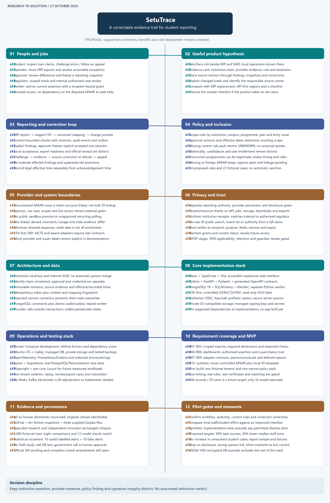

# Complete SetuTrace mind map

The map has **12 main branches and 82 detailed points**, covering people, product alternatives, reporting/corrections, policy/inclusion, integration boundaries, privacy/trust, data architecture, implementation stack, operations/testing, all ten requirements, evidence and pilot gates.

- [Editable tldraw canvas](https://www.tldraw.com/f/DiG3zof6ieq7J-LvirxSV) - individual nodes and connectors; zoom into a branch to read or edit. The canvas is editable by link, as configured by tldraw for a new board.
- [Scalable SVG poster](assets/mind-map.svg) - sharp at any zoom, suitable for sharing.
- [PNG poster](assets/mind-map.png) - convenient preview.
- [Canonical Mermaid source](mind-map.mmd) - portable editable hierarchy; the native canvas uses a manually corrected layout to avoid overlapping labels.
- [Complete report](solution-report.md) and [PDF](../output/pdf/solution-report.pdf) - evidence, source links, technical choices and limits behind each branch.

The map describes a proposed solution. The reproduced experiment is a sequential fictional model; no application was built during that research phase. The [current prototype](../prototype/README.md) implements a focused subset; no live provider call or field pilot is claimed. Proposed pilot targets are not measured results. Rebuild the local artifacts using `python tools/render_mind_map.py` from the repository root (Pillow required).
