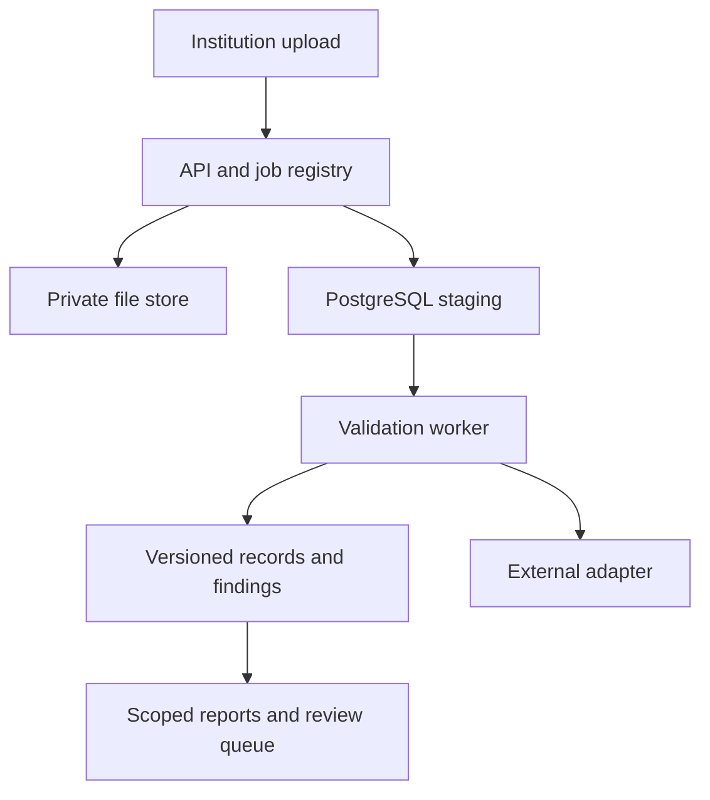

# Imported research source snapshot

Retrieved: 2026-10-26. Source: https://app.notion.com/p/403aaff5423381aa9c38cf282cb740db?pvs=204

Preserved source material; historical prompts are not current instructions. Prior experiment claims are not rerun evidence. Human review remains separate.

Here is the result of "fetch" for the Page with URL https://app.notion.com/p/403aaff5423381aa9c38cf282cb740db as of 2026-10-24T16:37:18.377Z:
<page url="https://app.notion.com/p/403aaff5423381aa9c38cf282cb740db" icon="🗃️">
<ancestor-path></ancestor-path>
<properties>
{"title":"Dharanish Research — Data Model & Architecture"}
</properties>
<iconMetadata>{"type":"emoji","emoji":"🗃️"}</iconMetadata>
<content>
<callout icon="🗃️" color="blue_bg">
<b>Recommendation:</b> A PostgreSQL-backed modular application with separate person links, institutional students, enrolments, approvals and credential references.<br />Everything labelled “proposed” below is our research design, not an accepted team decision or a government schema.
</callout>

<b>Owner:</b> Dharanish R P · <b>Research date:</b> <date start="2026-10-24" /> · <b>Human review:</b> Pending.

<table-of-contents />

## 1. Understand the problem before choosing tables

A person can attend more than one programme over time. One institution can hold several enrolment records for that person. An approval limits a particular offering under an applicable year/category rule. A credential is a separate claim issued by an awarding body.<br />Putting all of these in one “students” table makes a withdrawal look like deleting a person, turns a second legitimate enrolment into a duplicate and loses the context needed to explain intake alerts.<br /><b>Worked example — fictional:</b> SYN-ALPHA has one completed diploma and one later degree enrolment. That is one possible person identity and two enrolments. A degree certificate is a third kind of record. None of these facts alone proves that a current admission is compliant.<br />The supplied brief asks for uploads, validation, monitoring and authorised verification. Its official SIH wording remains independently unconfirmed. [DHA-001](https://zaidsayyed.in/tools/sih-problem-statements/sih26263)

## 2. Proposed architecture

Use one codebase with clear modules, one relational database, private object storage for incoming files, and an asynchronous worker. Keep external verification behind an adapter so an unavailable provider does not corrupt import state.



<b>Proposed deployment boundary:</b> API and worker may initially share one machine but run as separate processes. Modules include intake, mapping, validation, record revision, review, verification adapter and reporting. A database job table is enough for a small prototype; use an outbox when committed changes need reliable external dispatch.<br /><b>Why this approach:</b> relational relationships and transactions fit versioned records and scoped references. A modular monolith reduces deployment and distributed-failure work for a six-person team. This is an engineering tradeoff, not a source-certified “best stack.”<br /><b>Alternatives:</b> a document store could keep flexible raw submissions, but it would still need a strategy for cross-record rules and updates; a microservice design can separate organisational boundaries later but adds independent retries and deployment concerns now. Neither is inherently incapable.

## 3. Proposed entity model

<table fit-page-width="true" header-row="true">
<tr>
<td>
Entity
</td>
<td>
Purpose and key
</td>
<td>
Important design rule
</td>
</tr>
<tr>
<td>
institution
</td>
<td>
Internal institution\_id; external authority mappings
</td>
<td>
Do not equate names or one authority's code with every provider's ID.
</td>
</tr>
<tr>
<td>
institution\_student
</td>
<td>
Institution-scoped student\_id; local student key
</td>
<td>
Keep the institution's student identity distinct from national identity.
</td>
</tr>
<tr>
<td>
identity\_claim
</td>
<td>
Reported identifier, provider, evidence/status and checked time
</td>
<td>
Claims can be pending, disputed or superseded. No automatic person merge from an unverified value.
</td>
</tr>
<tr>
<td>
person\_link
</td>
<td>
Optional restricted internal person\_id linking verified claims
</td>
<td>
Cross-institution linkage requires approved authority and resolution process; defer activation.
</td>
</tr>
<tr>
<td>
programme\_offering
</td>
<td>
Institution, programme, campus, mode and relevant cohort
</td>
<td>
Capture the distinctions needed by rules; final catalogue awaits team inputs.
</td>
</tr>
<tr>
<td>
approval\_version
</td>
<td>
Authority, offering scope, applicable year, seat bucket, capacity and source
</td>
<td>
Keep revisions and applicability; never overwrite historical approval evidence.
</td>
</tr>
<tr>
<td>
enrolment
</td>
<td>
Stable enrolment\_id plus institution/source/source-record key
</td>
<td>
Multiple enrolments per student are allowed in the model; policy checks decide whether review is needed.
</td>
</tr>
<tr>
<td>
enrolment\_revision
</td>
<td>
Enrolment ID plus version; payload and provenance
</td>
<td>
Each accepted correction adds a version and preserves the previous one.
</td>
</tr>
<tr>
<td>
import\_job and import\_row
</td>
<td>
Tenant-scoped job/token; row number and raw-to-canonical provenance
</td>
<td>
Do not write unvalidated spreadsheet rows directly into canonical tables.
</td>
</tr>
<tr>
<td>
rule\_version and validation\_finding
</td>
<td>
Rule source/version; record version, outcome and evidence
</td>
<td>
A result must say which data and rule produced it.
</td>
</tr>
<tr>
<td>
verification\_attempt
</td>
<td>
Request purpose, provider/mode, claim, outcome and timestamps
</td>
<td>
Format check and provider confirmation are separate facts.
</td>
</tr>
<tr>
<td>
credential\_reference
</td>
<td>
Issuer, external reference, linked subject, status and evidence
</td>
<td>
Imported metadata is not automatically a verified credential.
</td>
</tr>
<tr>
<td>
audit\_event and outbox\_event
</td>
<td>
Actor/action/version and pending committed event
</td>
<td>
Audit is for accountability; outbox is for reliable dispatch. Neither is a student identity proof.
</td>
</tr>
</table>

An internal UUID avoids making a mutable or sensitive government identifier the technical primary key. A reported APAAR value can remain an academic lookup attribute with explicit verification evidence.

## 4. Field dictionary: prototype contract, not official CSV headers

<table fit-page-width="true" header-row="true">
<tr>
<td>
Field or group
</td>
<td>
Type / origin
</td>
<td>
Meaning and treatment
</td>
</tr>
<tr>
<td>
institution\_id
</td>
<td>
UUID; trusted authenticated context
</td>
<td>
Never accept another institution's ID merely because it appears in an uploaded row.
</td>
</tr>
<tr>
<td>
source\_system; source\_record\_key
</td>
<td>
Non-empty text; registered adapter
</td>
<td>
Stable enrolment identity within the institution. Require an explicit correction workflow when a source key itself changes.
</td>
</tr>
<tr>
<td>
institution\_student\_key
</td>
<td>
Text
</td>
<td>
Preserve leading zeros; uniqueness is scoped to issuer/institution.
</td>
</tr>
<tr>
<td>
reported\_apaar
</td>
<td>
Restricted nullable text
</td>
<td>
Store as text, not a number. Missing is distinguishable from invalid format and not checked. No generated real-looking IDs in fixtures.
</td>
</tr>
<tr>
<td>
identity\_state
</td>
<td>
Enum plus verification reference
</td>
<td>
missing / reported / format\_checked / provider\_confirmed / mismatch / unavailable; exact semantics await Sudhan.
</td>
</tr>
<tr>
<td>
programme\_ref; campus\_ref; mode
</td>
<td>
Versioned catalogue references
</td>
<td>
Unresolved codes become mapping questions, not guesses.
</td>
</tr>
<tr>
<td>
academic\_year; admission\_cohort
</td>
<td>
Canonical text/date references
</td>
<td>
Reporting year and entry cohort may differ. Do not compare all enrolled years against first-year intake.
</td>
</tr>
<tr>
<td>
entry\_route; seat\_bucket
</td>
<td>
Versioned code values
</td>
<td>
Admission route/category actually used; final values and counting rules await Pranav.
</td>
</tr>
<tr>
<td>
nationality / NRI / OCI / FN assertions
</td>
<td>
Separate reported attributes, nullable/unknown
</td>
<td>
Do not force overlapping concepts into one mutually exclusive enum or infer seat category from nationality.
</td>
</tr>
<tr>
<td>
status; effective\_from; effective\_to
</td>
<td>
Controlled state and dates
</td>
<td>
Proposed states: pending, active, withdrawn, completed, superseded. Null end date means still open/unknown according to the schema.
</td>
</tr>
<tr>
<td>
record\_version; expected\_version
</td>
<td>
Positive integer / write precondition
</td>
<td>
Detect stale edits; do not silently overwrite another operator's correction.
</td>
</tr>
<tr>
<td>
received\_at; effective\_at
</td>
<td>
UTC timestamp / source event time
</td>
<td>
Distinguish when the system learned a fact from when it became effective.
</td>
</tr>
<tr>
<td>
mapping\_version; rule\_set\_version
</td>
<td>
Immutable version references
</td>
<td>
Make interpretation and validation reproducible.
</td>
</tr>
<tr>
<td>
raw\_file\_ref; row\_number; digest
</td>
<td>
Restricted provenance
</td>
<td>
Trace a finding to a submission without copying full identifiers into logs.
</td>
</tr>
<tr>
<td>
validation\_outcome; finding\_code
</td>
<td>
Per-rule structured result
</td>
<td>
PASS / FAIL / REVIEW / UNKNOWN with a reason. Never collapse everything into one verified badge.
</td>
</tr>
</table>

Add personal fields such as date of birth only after purpose and access are justified. The model does not require names, phone numbers, Aadhaar or demographic traits for the executed synthetic experiment.

## 5. Integrity rules that can be designed now

<b>Technical facts:</b> PostgreSQL supports multi-column uniqueness and foreign keys; primary keys are non-null and unique. Nullable unique values have special semantics. Row-local CHECK constraints are not a general solution for counting other rows. [DHA-006](https://www.postgresql.org/docs/18/ddl-constraints.html)<br /><b>Our proposed invariants:</b>

- Enrolment uniqueness is scoped to institution + source system + stable source enrolment key.
- Include institution\_id in references from enrolment to institution\_student and programme\_offering, so a foreign-key mistake cannot cross tenants.
- Version is positive; known end date cannot precede known start date.
- A credential reference points to an issuer and subject without asserting verification.
- One current revision pointer must reference an existing immutable revision.
- Missing approval evidence yields UNKNOWN for the relevant rule.<br /><b>Illustrative SQL fragment — not a complete or executed schema:</b>

```sql
-- Assumes parent tables have matching composite unique keys.
CREATE TABLE enrolment (
  institution_id uuid NOT NULL,
  enrolment_id uuid NOT NULL,
  student_id uuid NOT NULL,
  offering_id uuid NOT NULL,
  source_system text NOT NULL,
  source_record_key text NOT NULL,
  version bigint NOT NULL CHECK (version > 0),
  start_date date,
  end_date date,
  PRIMARY KEY (institution_id, enrolment_id),
  UNIQUE (institution_id, source_system, source_record_key),
  FOREIGN KEY (institution_id, student_id)
    REFERENCES institution_student (institution_id, student_id),
  FOREIGN KEY (institution_id, offering_id)
    REFERENCES programme_offering (institution_id, offering_id),
  CHECK (end_date IS NULL OR start_date IS NULL
         OR end_date >= start_date)
);
```

Text emptiness/length, status transitions, permissions, history and RLS are additional requirements; this fragment is not production-ready.

## 6. Separate dimensions to avoid false conclusions

<b>Data integrity:</b> Is the row structurally well formed?<br /><b>Reference integrity:</b> Does its programme resolve in the approved catalogue?<br /><b>Identity evidence:</b> What has actually been confirmed about the reported identity?<br /><b>Policy result:</b> Does the applicable rule pass for the selected year/scope?<br /><b>Credential authenticity:</b> Is the issuer/record/status trustworthy?<br /><b>Authorisation:</b> May this actor access this field for this purpose?<br />These questions can have different answers for the same row. An unavailable provider must not become an invalid identity; a valid ID must not bypass intake checks.<br /><b>Reporting example:</b> the AISHE 2024–25 manual distinguishes reporting by a student's social category from admission category. We therefore propose separate fields and versioned report mappings instead of repurposing one category column. This observation concerns AISHE reporting, not AICTE seat-policy interpretation. [DHA-005, PDF page 15](https://cdnbbsr.s3waas.gov.in/s392049debbe566ca5782a3045cf300a3c/uploads/2024/12/20250728227262067.pdf#page=15)

## 7. Tenant isolation design, pending Sudhir's review

Use authenticated tenant context, least-privilege application roles, scoped object-store paths and explicit authorisation in API and worker code. Scope exports and job lookup just as strictly as interactive record reads.<br />PostgreSQL RLS is a useful additional boundary: its documentation describes default denial when enabled without an applicable policy, and bypass behaviour for owners/superusers. [DHA-008](https://www.postgresql.org/docs/18/ddl-rowsecurity.html)<br /><b>Proposal:</b> application connections should not be table owners or BYPASSRLS roles. Set tenant context transaction-locally from trusted authentication; clear pooled connection state; test denial with actual roles. Tenant context is not safe if clients can execute arbitrary SQL to change it.<br />A cross-institution detector must run under a separately authorised service role and return only an appropriately limited review signal. Do not expose another institution's student details to the uploader.

## 8. What is complete versus deferred

<b>Complete as research:</b> entity separation, a proposed field dictionary, integrity invariants, technical alternatives and review questions.<br /><b>Deferred:</b> actual provider payload mappings; authoritative programme/approval identifiers; admission-category rules; final permission/retention matrix; verified demand and report definitions; accepted team architecture.<br />These dependencies do not prevent building a clearly synthetic import demonstration.

## 9. Explain it back

“Why is APAAR not the primary key of every table?” Answer using one person, two enrolments and one corrected record. Then identify which entities must carry institution scope and why.<br /><b>Your explanation and Kanishkar's review remain pending.</b>
</content>
</page>

