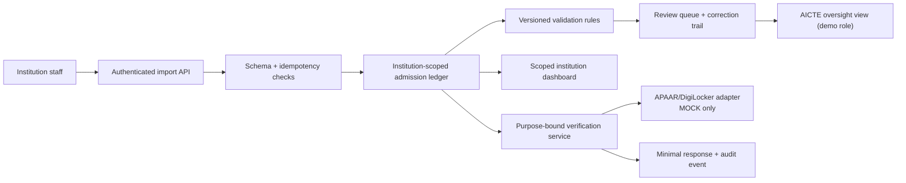

# Imported research source snapshot

Retrieved: 2026-10-26. Source: https://app.notion.com/p/403aaff5423381959dbfc23c6d1ee700?pvs=204

Preserved source material; historical prompts are not current instructions. Prior experiment claims are not rerun evidence. Human review remains separate.

Here is the result of "fetch" for the Page with URL https://app.notion.com/p/403aaff5423381959dbfc23c6d1ee700 as of 2026-10-24T03:35:58.165Z:
<page url="https://app.notion.com/p/403aaff5423381959dbfc23c6d1ee700" icon="🧪">
<ancestor-path></ancestor-path>
<properties>
{"title":"Kanishkar B — SIH APAAR Research Notebook"}
</properties>
<iconMetadata>{"type":"emoji","emoji":"🧪"}</iconMetadata>
<content>
<callout icon="🧪" color="yellow_bg">
<b>Provisional leadership research, started </b><b><date start="2026-10-24" /></b><b>.</b> This is an AI-assisted evidence notebook, NOT an accepted architecture, official SIH verification, completed teammate research, implementation, test result, or human learning review. All sample records below are fictional.
</callout>

[Leadership assignment](https://github.com/Dharanish99/SIH_APAAR_Student_Verification/blob/main/research/kanishkar/README.md) · [Problem brief](https://github.com/Dharanish99/SIH_APAAR_Student_Verification/blob/main/docs/problem-brief.md) · [Requirements matrix](https://github.com/Dharanish99/SIH_APAAR_Student_Verification/blob/main/docs/requirements.md) · <mention url="https://app.notion.com/p/402aaff5423381bbaf3fcc1030c9601f" />

<table-of-contents />

## Mission, access and current status

<b>Mission:</b> Choose an evidence-backed, practical solution to SIH26263 that a six-person team can demonstrate truthfully, while maintaining a path to a permitted institutional pilot.

<b>Read during this pass:</b> The repository's main-branch README, [AGENTS.md](http://AGENTS.md), [CONTRIBUTING.md](http://CONTRIBUTING.md), team.json, docs/[problem-brief.md](http://problem-brief.md), [research-standards.md](http://research-standards.md), [source-guide.md](http://source-guide.md), [requirements.md](http://requirements.md), [decisions.md](http://decisions.md) and [risks.md](http://risks.md); Kanishkar's README, findings, sources and progress; and all five other members' findings, source registers and progress files. The Notion hub and six tailored research prompts were inspected.

<b>Access report:</b> Web source research available. GitHub repository read available through a connected account, but the account used has <code>pull=true</code> and <code>push=false</code>; no GitHub files were changed. Notion page creation available. No provider API credentials or access to real student records was demonstrated. No experiments or interviews executed. Notion notebook created as a private draft; no team sharing or reviews were performed.

<b>Five other workstreams:</b> Gopika, Sudhan, Pranav, Dharanish and Sudhir each remain <code>Not started</code> in their checked GitHub progress files as of this read; their source CSVs contain headers only. Do not infer whether anyone researched privately elsewhere.

## 10-minute orientation — the problem and the strongest provisional direction

The supplied third-party SIH statement describes inconsistent collection of student-level enrolment information from AICTE-approved institutions. The desired workflow is institution submission → validation → oversight → purpose-restricted verification. This remains a <i>supplied baseline</i> until the official SIH statement is independently recovered. See [the supplied problem listing](https://zaidsayyed.in/tools/sih-problem-statements/sih26263).

<b>Provisional architecture recommendation:</b> Build a synthetic-data, evidence-aware institutional admission ledger with versioned intake rules, reviewable anomaly flags, tenant-scoped dashboards and verification responses. Define a provider adapter with explicit states <code>MOCK</code>, <code>SANDBOX_AUTHORISED</code> and <code>PRODUCTION_AUTHORISED</code>; implement only MOCK until actual access is proved. Never label an ID-format check as APAAR validation.

<b>Why this direction:</b> [APAAR](https://apaar.education.gov.in/faqs) describes identity and academic ecosystem links; [DigiLocker partner onboarding](https://api.apisetu.gov.in/) explicitly requires application, API-key provisioning, development, testing/audit and go-live stages. We have not demonstrated eligibility, credentials or live access. No proprietary scoring or unverifiable government access is needed to demonstrate the core institutional review workflow.

## Glossary — terms to explain in the jury room

- <b>APAAR:</b> Automated Permanent Academic Account Registry, a national academic identity initiative; its identifier is not by itself proof of a particular admission.
- <b>ABC:</b> Academic Bank of Credits, the ecosystem for recording and transferring academic credits.
- <b>NAD:</b> National Academic Depository, academic award/credential infrastructure.
- <b>AICTE:</b> All India Council for Technical Education, relevant regulator/approval authority.
- <b>EoA:</b> Extension of Approval for the relevant academic year, as defined in AICTE's handbook.
- <b>RBAC / ABAC:</b> Role-Based / Attribute-Based Access Control. A role alone is often insufficient; also check institution, purpose, action and record.
- <b>Idempotent import:</b> Retrying the same upload cannot produce unintended duplicate entries.
- <b>Evidence provenance:</b> Where an assertion came from, its date, scope and trust level.
- <b>Synthetic data:</b> Artificial test records that do not identify real students.
- <b>Acceptance test:</b> An observable condition that can show whether one requirement is satisfied.

## What the evidence actually supports

### F1 — APAAR is an academic identity ecosystem, not a magic validity oracle

The [official APAAR FAQ](https://apaar.education.gov.in/faqs) describes a 12-digit academic identifier and links to ABC/DigiLocker. The currently indexed official-page text is readable, but direct page opening returned 403 in this pass. <b>Evidence grade: official-source discovery / direct access incomplete.</b> Treat school-UDISE prerequisites as potentially school-specific, not automatically applicable to all higher-education learners. Distinguish <i>identifier supplied</i>, <i>format acceptable</i>, <i>identity linked</i>, <i>record issuer trusted</i>, <i>enrolment currently valid</i> and <i>authorised disclosure</i>.

### F2 — DigiLocker requester access is a real dependency

[Official DigiLocker partner page](https://api.apisetu.gov.in/) lists stages: apply, get API key, develop interfaces, integrate, test/audit, go live. [API Setu DigiLocker resources](https://apisetu.gov.in/digilocker) list issuer and requester specifications, including Requester v1.12 (October 2023). These documents do not grant us access or establish a dedicated APAAR verification endpoint. <b>Implication:</b> Have a locally controllable mock boundary, explicit fake-response labels, and a gate before any live integration work.

### F3 — A single hard-coded intake threshold would be unsafe

The [AICTE Approval Process Handbook 2024–25 to 2026–27](https://aicte.gov.in/sites/default/files/APH%20Final.pdf) defines EoA and distinguishes approved intake from supernumerary places; its section 2.9 discusses FN/OCI/children of Indian workers in Gulf countries subject to conditions. Parsed official PDF text was inspected; the visual screenshot of this particular PDF was unavailable. <b>Unknown:</b> all later addenda, the institution-specific EoA, category authorization and course/year exceptions. <b>Implication:</b> Require versioned approval evidence and category-specific rules; never automatically reject based on one overall count.

### F4 — Privacy provisions have phased commencement

The [Digital Personal Data Protection Rules, 2025, G.S.R. 846(E)](https://www.meity.gov.in/static/uploads/2025/11/53450e6e5dc0bfa85ebd78686cadad39.pdf), gazetted 13 November 2025, Rule 1 states different commencement: Rules 1, 2, 17–21 on publication; Rule 4 one year later; Rules 3, 5–16, 22–23 eighteen months later. The English Gazette page was visually checked. Do not generalise this into a declaration that the proposed product is compliant; the Act's separately commenced provisions, other laws and actual processing roles also need legal assessment.

### F5 — Knowing an APAAR ID is not permission to read a record

[OWASP Authorization Cheat Sheet](https://cheatsheetseries.owasp.org/cheatsheets/Authorization_Cheat_Sheet.html) recommends least privilege, deny-by-default and checks on each request, including specific object ownership. <b>Proposed implementation:</b> Every query checks actor, institution scope, intended purpose, action and disclosure policy. A verification response reveals only the fields needed for its purpose, with audit logs and a disputed/unavailable state.

### Open contradiction to investigate

The supplied problem asks for 'real-time verification', while the provider onboarding evidence proves only that authorised integration can be pursued. This is <b>not a contradiction in government policy</b>; it is a gap between desired capability and currently evidenced access. Resolve it by getting written partner/API eligibility and exact permitted methods, or keep the demo explicitly simulated.

## Requirement → feature → owner → acceptance-test trace (provisional)

<table fit-page-width="true" header-row="true">
<tr>
<td>
Requirement / owner
</td>
<td>
Proposed handling and dependency
</td>
<td>
Acceptance test (not run)
</td>
</tr>
<tr>
<td>
R01 Upload/update — Dharanish
</td>
<td>
Institution-scoped import with reconciliation keys; needs field schema
</td>
<td>
Retry same batch and confirm no duplicate active admissions
</td>
</tr>
<tr>
<td>
R02 Intake and categories — Pranav
</td>
<td>
Year/course/category-aware schema; needs versioned EoA + rule source
</td>
<td>
One FN/OCI supernumerary case evaluated against correct rules
</td>
</tr>
<tr>
<td>
R03 Flags — Dharanish
</td>
<td>
Missing/format/conflict/over-capacity as separate review reasons; needs policy interpretations
</td>
<td>
Each injected synthetic anomaly gets its intended reason
</td>
</tr>
<tr>
<td>
R04 Dashboards — Gopika
</td>
<td>
Institution vs oversight aggregate views; define update freshness
</td>
<td>
Two institutions show different scoped totals
</td>
</tr>
<tr>
<td>
R05 Stakeholder verification — Sudhir
</td>
<td>
Purpose-bound minimal disclosure; partner status separate
</td>
<td>
Cross-institution/unauthorised employer query denied
</td>
</tr>
<tr>
<td>
R06 Verifiable records — Sudhir
</td>
<td>
Issuer claim + provenance and status, not QR alone
</td>
<td>
Tampered/revoked synthetic credential fails verification
</td>
</tr>
<tr>
<td>
R07 APIs — Sudhan
</td>
<td>
Versioned adapter contract; MOCK now, live if authorised
</td>
<td>
Mock-offline path leaves claim 'unverified' not 'valid'
</td>
</tr>
<tr>
<td>
R08 Security/privacy — Sudhir
</td>
<td>
Server enforcement, audit trail, field minimisation; counsel review later
</td>
<td>
Negative access tests and audit assertions pass
</td>
</tr>
<tr>
<td>
R09 Reports — Gopika
</td>
<td>
Enrolment and exception aggregation, definitions & access
</td>
<td>
Export reproduces checked synthetic dashboard counts
</td>
</tr>
<tr>
<td>
R10 Certificate ID display — Sudhir
</td>
<td>
Fictional certificate preview, issuer-controlled template needed
</td>
<td>
Print preview shows both <i>fictional</i> identifiers and source label
</td>
</tr>
</table>

All R01–R10 descriptions above come from the supplied third-party problem baseline and the team's [requirements document](https://github.com/Dharanish99/SIH_APAAR_Student_Verification/blob/main/docs/requirements.md). Official SIH wording and accepted acceptance criteria remain unverified.

## Compare architecture approaches

<table fit-page-width="true" header-row="true">
<tr>
<td>
Dimension
</td>
<td>
Option A — Integration-first centralised system
</td>
<td>
Option B — Evidence-first ledger + adapter (proposed)
</td>
</tr>
<tr>
<td>
Access dependency
</td>
<td>
Blocked if government API access is absent
</td>
<td>
Core demo independent; provider capability marked simulated
</td>
</tr>
<tr>
<td>
Learning / user value
</td>
<td>
Best if genuine authoritative data flows available
</td>
<td>
Demonstrates error correction, approvals, review and access scope
</td>
</tr>
<tr>
<td>
Engineering effort
</td>
<td>
Higher onboarding, contracts and data governance needs
</td>
<td>
Smaller MVP, but future adapter and migration still substantial
</td>
</tr>
<tr>
<td>
Privacy
</td>
<td>
More third-party handling, real-world approvals needed
</td>
<td>
Synthetic and scoped data in demo; real pilot still requires assessment
</td>
</tr>
<tr>
<td>
Maintenance
</td>
<td>
External interface changes and availability matter
</td>
<td>
Internal validation remains maintainable; future provider maintenance remains
</td>
</tr>
<tr>
<td>
Jury proof
</td>
<td>
Only compelling with genuine authorised access
</td>
<td>
Clear demonstrable behaviour and explicitly bounded claims
</td>
</tr>
</table>

<b>Recommendation (not accepted):</b> Prototype B and design A as an eventual permitted extension. Reconsider if Sudhan obtains a written authorisation, usable credentials, permitted endpoint documentation and test evidence.

## Proposed end-to-end flow / conceptual architecture

<b>Data model sketch (not approved):</b> Institution, Programme, ApprovalVersion, AcademicYear, AdmissionRecord, StudentReference (pseudonymous internal key), IdentityClaim, IssuerEvidence, ValidationFinding, ReviewAction, VerificationRequest, AccessGrant and AuditEvent. A repeat of an identifier across institutions is a <i>potential conflict requiring context</i>, not automatic fraud.

## Build-now / simulated / later / excluded

- <b>Build now (proposed):</b> login + test roles; two fictional institutions; CSV and API upload/update; record versioning; field diagnostics; versioned simple admission rule fixtures; review queue; scoped counts; basic minimal verification; audit events; scenario test pack.
- <b>Clearly simulated:</b> APAAR identity lookup, DigiLocker issuer/requester outcomes, AICTE official data feeds, government-level verification and approved-intake evidence fixtures. Put 'SIMULATED — NOT AN OFFICIAL VERIFICATION' at interface and in documentation.
- <b>Later, conditional on access:</b> actual provider integration; real institutional EoA feeds; legal/purpose assessment; live learner consent/authority processes; credential issuer registration; production security review.
- <b>Exclude now:</b> production Aadhaar handling, real student imports, real regulatory adjudication, automatic fraud accusations, real certificate issuance, claims of live government affiliation, public identity search.

## Synthetic demo script and edge cases — scenarios, not performed results

1. <b>Normal case:</b> Institution A uploads 20 fictional valid admissions against an explicitly fictional course capacity. Dashboard shows accepted rows; a permitted demo actor receives only limited confirmation.
2. <b>Duplicate retry:</b> Same CSV uploaded again with same import key. Expected: no duplicate admissions; audit links both attempts.
3. <b>Potential cross-institution enrolment:</b> Same fictional learner reference appears in A and B. Expected: 'needs human review', not fraud or automatic deletion; allow legitimate sequential transfers.
4. <b>Over-intake with supernumerary exception:</b> Intake of base category reaches the fictional threshold while one correctly tagged and authorised FN/OCI supernumerary case appears. Expected: apply <b>case-specific</b> fixture instead of blanket rejection; actual applicable rules remain to be verified by Pranav.
5. <b>No APAAR result:</b> Adapter returns simulated unavailable. Expected: distinguish 'not checked', 'unavailable', 'format issue' and 'issuer-confirmed mismatch'.
6. <b>Access boundary:</b> Institution A staff requests B's row; employer without purpose/authority requests personal fields. Expected: deny with auditable reason; no data leak.
7. <b>Tampered credential:</b> Modify a synthetic signed claim after issuance or mark it revoked. Expected: failed/expired/revoked response; scanning its QR is not sufficient.

<b>Proposed measurable acceptance targets — NOT results:</b> Every specifically injected issue is identified by its designated fixture test; all scripted unauthorised requests are denied; repeated import is idempotent; every manually overridden finding has an actor/reason/time event; all screens involving providers show MOCK status. Measure with named test fixtures and record numerator/denominator. Do not claim production accuracy.

## Milestones — gates rather than invented delivery dates

1. <b>G0 Evidence baseline:</b> Obtain exact official statement; inventory open gaps; each workstream selects top 3 questions. Exit: source register entries or blocker records.
2. <b>G1 Rules and integration contract:</b> Receive field dictionary, rule versions, provider allowed paths and access model. Exit: synthetic acceptance cases + no unstated access assumptions.
3. <b>G2 Vertical slice:</b> Implement import → ledger → flag → reviewer resolution → dashboard → verification. Exit: demonstrable fictional scenario and reproducible tests.
4. <b>G3 Security and negative testing:</b> Tenant-isolation tests, tamper/revocation, logs, idempotency and offline provider. Exit: evidence for each pass/fail, defects recorded.
5. <b>G4 Team defence:</b> Each owner completes a 7-minute human-reviewed teach-back. Exit: reviewed explanations, decision log and clearly bounded claims. No deadline or resource allocation is approved by the team yet.

## Cost / effort register (pricing and estimates pending)

Before committing architecture, obtain dated official pricing and expected units for: hosting ₹/month and transfer GB/month; database ₹/month by storage + reads/writes; object storage GB/month; SMS/email ₹/message; domain ₹/year; provider onboarding and API pricing if documented; security-audit cost; engineer-hours per module; operational and incident handling. A purely local demo may have no incremental hosted-billing line if built on existing resources, but hardware, electricity, maintenance and labour are not 'free'. Values currently <b>TBD</b> pending selected stack, workload and official price list. Maintain base/worst-case scenarios; never invent API fees.

## Critical risks / unresolved decisions

<table fit-page-width="true" header-row="true">
<tr>
<td>
Risk / status
</td>
<td>
What would resolve it
</td>
<td>
Owner
</td>
</tr>
<tr>
<td>
Official SIH wording unavailable — open
</td>
<td>
Direct official SIH listing or authenticated event material
</td>
<td>
Kanishkar
</td>
</tr>
<tr>
<td>
Real APAAR/DigiLocker access unproved — open
</td>
<td>
Written provider eligibility, approved scope and credentials
</td>
<td>
Sudhan
</td>
</tr>
<tr>
<td>
Course/year/category rule ambiguity — open
</td>
<td>
Current APH addenda, institution EoA and valid worked cases
</td>
<td>
Pranav
</td>
</tr>
<tr>
<td>
Student and staff workflow unobserved — open
</td>
<td>
Permitted interviews, redacted workflow and existing product comparison
</td>
<td>
Gopika
</td>
</tr>
<tr>
<td>
Import consistency and actual data model — open
</td>
<td>
Reproducible fictional fixtures, correction lifecycle and tests
</td>
<td>
Dharanish
</td>
</tr>
<tr>
<td>
Privacy/authorisation/legal basis — open
</td>
<td>
Purpose and permissions map, current law analysis, negative tests, relevant counsel review
</td>
<td>
Sudhir
</td>
</tr>
<tr>
<td>
Novelty versus existing public infrastructure — open
</td>
<td>
Fair feature/role comparison with APAAR, ABC, NAD, DigiLocker and existing AICTE processes
</td>
<td>
Kanishkar + all
</td>
</tr>
</table>

## Learning route — four modules

### Module 1: Traceability and evidence quality

<b>Plain meaning:</b> Every proposed button needs a real problem, evidence, owner and observable test. <b>Definition:</b> Requirements traceability connects source requirement → user/workflow need → design → verification evidence. <b>Synthetic worked example:</b> Requirement 'detect excess enrolment' → fictional EoA capacity and year → rule engine → reviewer queue → injected over-limit test. <b>Two failure cases:</b> 1) A competitor blog is cited as law; 2) a tested prototype screenshot is used to claim real government approval. <b>Reading:</b> [Requirements](https://github.com/Dharanish99/SIH_APAAR_Student_Verification/blob/main/docs/requirements.md), [AICTE APH](https://aicte.gov.in/sites/default/files/APH%20Final.pdf). <b>Design effect:</b> explicit source and version fields for findings.

### Module 2: Dependencies and feasibility gates

<b>Plain meaning:</b> If one outside organisation must approve access, a system that requires that access is not fully under your team's control. <b>Definition:</b> A feasibility gate is a condition that must be demonstrated before promising a dependent feature. <b>Synthetic worked example:</b> An interface returns a clearly MOCK response while requester onboarding is pending. <b>Two failure cases:</b> 1) Treating API documentation as valid credentials; 2) returning 'student verified' when the upstream provider is offline. <b>Reading:</b> [DigiLocker onboarding](https://api.apisetu.gov.in/). <b>Design effect:</b> adapter mode is visible and verifiability is claim-specific.

### Module 3: MVP scope and cost assumptions

<b>Plain meaning:</b> An MVP is the smallest end-to-end system proving the important workflow, not a collection of pretty dashboards. <b>Definition:</b> MVP = minimum viable product with enough coherent user behaviour to test the principal value hypothesis. <b>Synthetic worked example:</b> CSV import produces one reviewable finding with a corrective action and updated dashboard. <b>Two failure cases:</b> 1) Adding AI fraud scoring before ground-truth labels exist; 2) assuming unlimited free hosting despite data-transfer and operational costs. <b>Reading:</b> [Problem baseline](https://zaidsayyed.in/tools/sih-problem-statements/sih26263), [repository risk register](https://github.com/Dharanish99/SIH_APAAR_Student_Verification/blob/main/docs/risks.md). <b>Design effect:</b> prioritize a vertical slice and real price units.

### Module 4: Evaluation, demo boundaries and review

<b>Plain meaning:</b> Show what the application did, how you measured it, and what you did not prove. <b>Definition:</b> Evaluation compares specified acceptance conditions with recorded results from reproducible tests. <b>Synthetic worked example:</b> Run a 20-case authorisation test pack and record denied/allowed outcomes plus audit entries. <b>Two failure cases:</b> 1) Calling 20 fabricated test successes 'production 100% accuracy'; 2) a QR URL being treated as a signed, revocable academic award. <b>Reading:</b> [OWASP Authorization Cheat Sheet](https://cheatsheetseries.owasp.org/cheatsheets/Authorization_Cheat_Sheet.html). <b>Design effect:</b> logged negative tests and explicit human review gates.

## Evidence ledger — inspected on <date start="2026-10-24" />

- <b>KAN-001 — Partial/secondary:</b> [SIH26263 supplied listing](https://zaidsayyed.in/tools/sih-problem-statements/sih26263), publisher Zaid Sayyed, version unknown, available via search result; direct opening unavailable. Supports a <i>provisional</i> problem baseline, not official deadlines/wording.
- <b>KAN-002 — Partial official:</b> [APAAR FAQ](https://apaar.education.gov.in/faqs), Ministry of Education / APAAR, version unknown, indexed official content visible but direct open 403. Supports discovery of identity ecosystem, not live third-party access.
- <b>KAN-003 — Inspected official:</b> [DigiLocker partner page](https://api.apisetu.gov.in/), NeGD/DigiLocker, onboarding steps, version unknown. Supports need for partner enrolment, API key and testing, <b>not</b> that our team is eligible.
- <b>KAN-004 — Inspected official resource listing:</b> [DigiLocker API resource centre](https://apisetu.gov.in/digilocker), NeGD/API Setu, requester specification listed v1.12 (Oct 2023). The linked full requester specification was not assessed in this pass.
- <b>KAN-005 — Official PDF parsed, image unconfirmed:</b> [AICTE APH 2024–25 to 2026–27](https://aicte.gov.in/sites/default/files/APH%20Final.pdf), Definitions for EoA and Clause 2.9 supernumerary cases; exact applicable amendments/EoA outstanding.
- <b>KAN-006 — Official PDF visually inspected:</b> [DPDP Rules Gazette G.S.R. 846(E)](https://www.meity.gov.in/static/uploads/2025/11/53450e6e5dc0bfa85ebd78686cadad39.pdf), Rule 1 on Gazette printed p.24 / PDF p.24 if counted from 1, dated 13 November 2025. Supports staggered commencement of <i>Rules</i>; not full legal compliance.
- <b>KAN-007 — Inspected engineering guidance:</b> [OWASP Authorization Cheat Sheet](https://cheatsheetseries.owasp.org/cheatsheets/Authorization_Cheat_Sheet.html), current web guidance, 'Enforce Least Privileges', 'Deny by Default', 'Validate Permissions on Every Request'. Supports engineering controls, not Indian legal authority.

<b>Source-quality caveat:</b> Original SIH portal [problem statement page](https://www.sih.gov.in/sih2026PS) could not be fetched on this pass. This is a documented access gap, not proof the third-party text matches exactly.

## Concrete handoff for GitHub — proposed content only

<b>GitHub writes NOT performed:</b> the checked connection cannot push. Place reviewed synthesis in <code>research/kanishkar/findings.md</code>, append source details above as KAN-001 … KAN-007 following the existing <code>sources.csv</code> schema, and add a dated factual entry in <code>progress.md</code>. Preserve the real reviewer field as <b>Not reviewed</b>. Consider a research branch and PR when a connected account has permitted write access.

- <b>To Gopika:</b> obtain actual, permissioned admin workflow examples; define measures and freshness; distinguish observed vs requested.
- <b>To Sudhan:</b> verify requester onboarding eligibility and actual APAAR/DigiLocker access; specify stable adapter contract and outage semantics.
- <b>To Pranav:</b> link EoA year/course to FN/OCI/supernumerary decisions and exceptions; three worked rule cases.
- <b>To Dharanish:</b> prove idempotent import and audit history with reproducible synthetic fixtures; do not infer identity from format.
- <b>To Sudhir:</b> produce multi-institution permission matrix; make issuer authenticity, expiry and revocation separately testable.

## Human learning and peer review

- [ ] Kanishkar personally opened two primary-source passages and explained their scope.
- [ ] Kanishkar explained one normal case and two edge cases in own words.
- [ ] Kanishkar completed the seven-minute verbal explanation, without reading the AI draft.
- [ ] Kanishkar removed one unavailable integration from the hypothetical architecture and defended what remains.
- [ ] All five owners supplied their real findings and answered novel review cases.
- [ ] Peer review occurred and reviewer/date/issues were recorded.

<b>My own explanation — HUMAN ACTION REQUIRED:</b> Leave this section blank until Kanishkar writes it. No first-person statement has been AI-drafted as if spoken by the student.

<b>Opening teach-back question (do not fill in an AI answer):</b> Suppose DigiLocker declines requester onboarding and the official APAAR verification endpoint is unavailable. What exactly can our MVP still prove to an SIH jury, and which claims must we stop making?
</content>
</page>

